# Demo

Everything on this page was produced by the final model (`weights/yolo26n_finetuned.pt`) through the full
pipeline: detection → geometric distance → annotation as `Class, distance`.

## Video showcase

Each clip is a nuScenes front-camera sequence at 12 Hz with the camera's real calibration. Left: detections
labelled with their estimated distance. Right: the bird's-eye view from the ground homography; on LiDAR key
frames (every 6th frame) white crosses show the ground-truth positions. The animated previews show the first
seconds; click one for the full H.264 video.

| Singapore construction zone — barriers and cones while turning (19 s) |
|---|
| [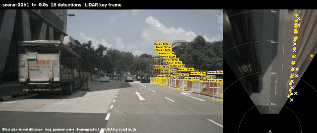](assets/videos/singapore_construction.mp4) |

| Boston — approaching a line of cones from 58 m down to 16 m (12 s) |
|---|
| [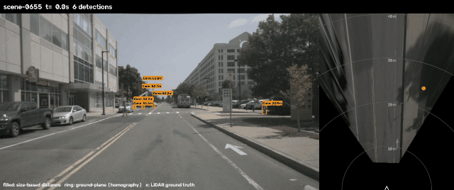](assets/videos/boston_cones.mp4) |

| Night — barriers along a dark road (20 s) |
|---|
| [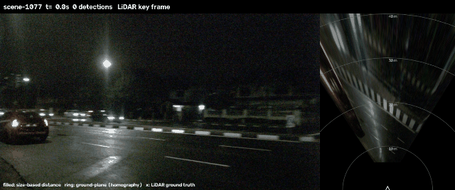](assets/videos/night_barriers.mp4) |

The night clip also shows the main failure mode: in the first seconds the red tail-lights of the car ahead
are detected as cones: at night a red light looks much like an orange cone. More night-time training data,
or hard-negative mining (adding tail-light crops as background), would address it.

**Cone tracking with optical flow:** [assets/videos/cone_tracking.mp4](assets/videos/cone_tracking.mp4)
(see section 5).

Rendered with `extras/birds_eye_view.py`, for example:

```bash
python -m extras.birds_eye_view --weights weights/yolo26n_finetuned.pt video --scene 0 --frames 240 --out assets/videos/singapore_construction.mp4
```

## 1. Detections, distances and a bird's-eye view (nuScenes, real calibration)

Left: camera image with each detection labelled with its estimated distance. Right: the camera image warped
onto the road plane with the ground homography $H = K\,[\,r_1 \; r_2 \; t\,]$. Filled dots are the size-based
distance estimates, rings are the homography back-projection of each object's ground-contact point, and
**white crosses are the LiDAR ground-truth positions**.

**Cones along a work zone (Boston)**
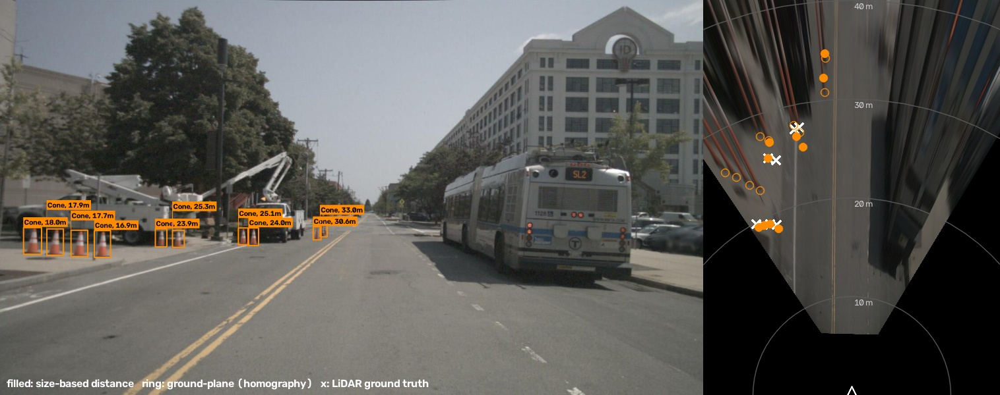

**A row of barriers from 12 to 41 m (Singapore)**
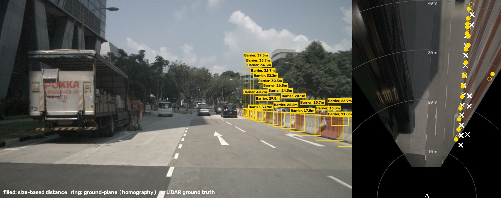

**Street scene (Boston): the 12.4 m cone lands on its LiDAR position**
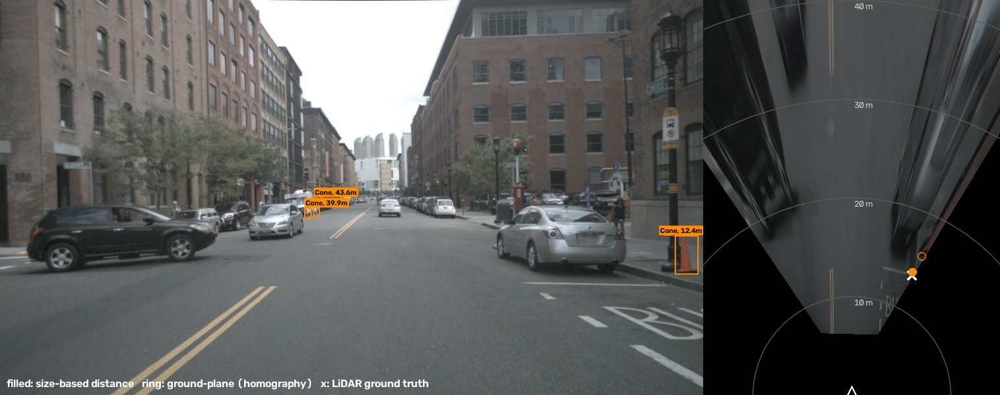

## 2. Estimate vs. LiDAR ground truth (nuScenes)

Each matched detection shows the estimated distance and, in brackets, the LiDAR distance. Over all 366 matched
objects the error is 4.7 % for cones and 5.7 % for barriers ([RESULTS.md](RESULTS.md#2-distance-accuracy-against-lidar)).

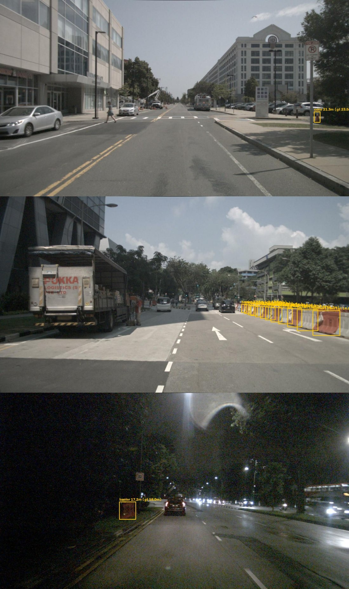

## 3. nuImages with each image's own calibration

Distances use the focal length from each image's calibration (≈ 1260 px at 1600×900). Includes a Singapore
stop sign, cones from 9 to 37 m and a construction zone with barriers.

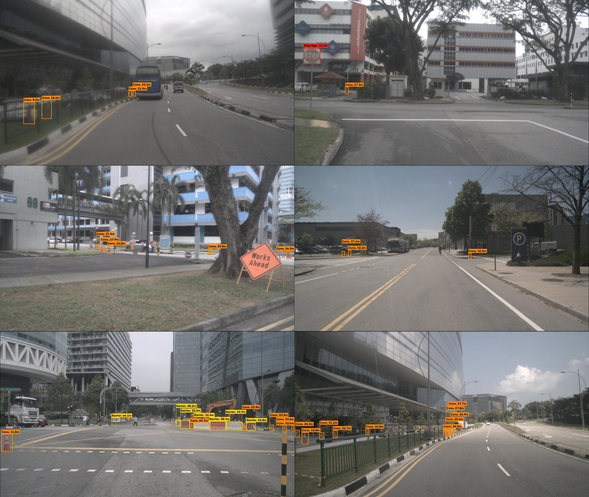

## 4. BDD100K dashcam images (assumed focal length)

BDD100K publishes no calibration, so these distances use an assumed 60° horizontal field of view
(f ≈ 1109 px at 1280×720) and are approximate.

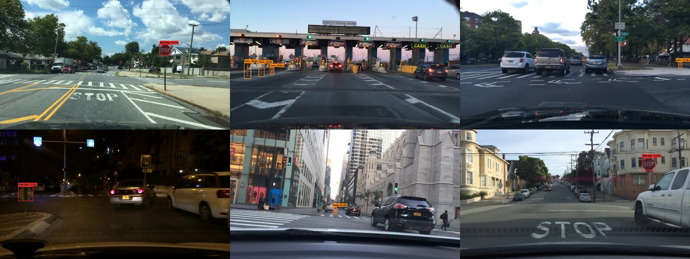

## 5. Tracking cones with optical flow (nuScenes, 12 Hz)

The detector runs on every 6th frame; in between, each cone is followed with Lucas–Kanade optical flow and its
distance updated every frame as the car drives past (IDs stay with the same cone).

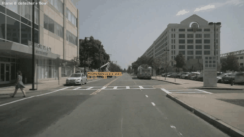

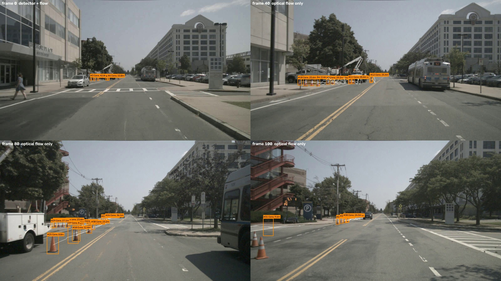

Known limitation, visible in the last frame: between detector frames a track can slide off a low-texture
object, and cones very close to the camera are sometimes missed.

## Run it yourself

```bash
python demo.py --weights weights/yolo26n_finetuned.pt --source path/to/images_or_video --camera configs/camera_bdd100k.yaml
python demo.py --weights weights/yolo26n_finetuned.pt --source 0 --camera configs/camera_example_calibrated.yaml
python demo.py --weights weights/yolo26n_finetuned_int8_openvino_model --source path/to/video.mp4 --device intel:cpu
```

* `--camera` takes a camera file: an assumed field of view (`configs/camera_bdd100k.yaml`) or a calibrated
  camera from `python -m distance.camera` (`configs/camera_example_calibrated.yaml` shows the format).
* Annotated images or an annotated video are written to `outputs/infer/`, together with `detections.json`
  (class, confidence, box, distance, method).
* `--source 0` uses a webcam.
