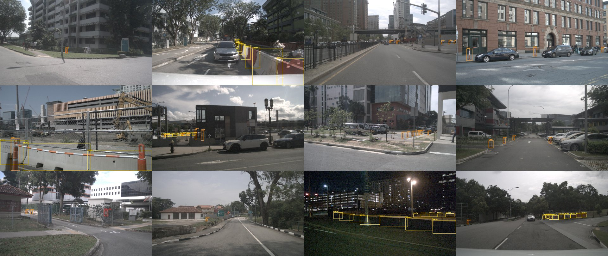
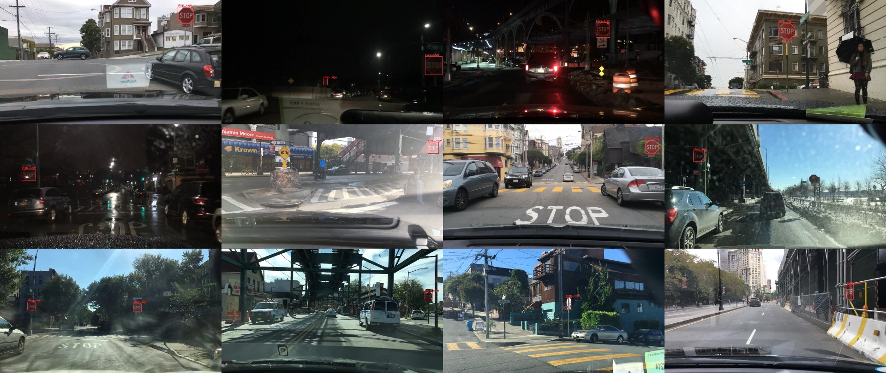
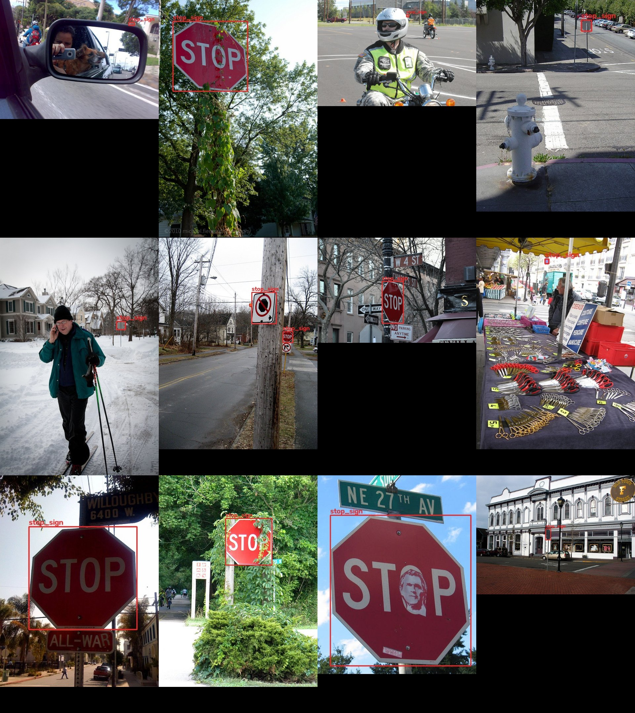

# Object Detection + Distance Estimation for Robot Navigation

**Author:** Siddhartha Mallavolu · ERIC Robotics ML assignment

Detects **cones, barriers and stop signs**, estimates each object's **distance from the camera with
pinhole-camera geometry**, annotates the result as `Cone, 1.5m`, and compares optimised model variants for
edge hardware (FPS on CPU and GPU, before vs. after).


<sub>Left: detections annotated with their estimated distance. Right: the same detections on a top-down map
built with the ground-plane homography; white crosses are LiDAR ground-truth positions.</sub>

**Demo videos and images → [DEMO.md](DEMO.md) · Full numbers → [RESULTS.md](RESULTS.md) · Raw result files → [`results/`](results/)**

## Key results

| | |
|---|---|
| Detector | **YOLO26n** fine-tuned from COCO: **mAP50 0.765 · mAP50-95 0.528** (cone 0.784, barrier 0.691, stop sign 0.819 AP50) |
| Distance vs. LiDAR | median error **0.55 m (cones)**, **0.93 m (barriers)**; mean relative error **4.7 % / 5.7 %** on 366 nuScenes objects |
| Edge, CPU | OpenVINO **INT8: 30.9 ms → 28.7 FPS** end-to-end on a laptop i5 (PyTorch FP32: 42.4 ms), 3.3 MB, −0.4 mAP50 |
| Edge, GPU | GTX 1650 FP32: 11.6 ms (68 FPS); Intel Iris Xe iGPU INT8: 9.7 ms (63 FPS) |

[](assets/videos/boston_cones.mp4)
<sub>Video demo (click for the full clip; more in [DEMO.md](DEMO.md#video-showcase)).</sub>

## Assignment checklist

| Requirement | Where |
|---|---|
| Detect cones, barriers, stop signs | §2 · `detection/` |
| Work with BDD100K (+ other datasets) | §1 · BDD100K + nuImages + COCO; nuScenes for evaluation |
| Transfer learning, clean modular code | §2 · COCO-pretrained YOLO fine-tuned; one folder per task |
| Distance per object, annotated as `Cone, 1.5m` | §3 · `distance/`, `detection/detector.py`, `demo.py` |
| Distance based on geometry (focal length, pixel size) | §3 · pinhole model, no learned depth |
| Quantization / pruning / lightweight backbone | §4 · `optimization/` |
| FPS on CPU and GPU, before vs. after | §4 · [RESULTS.md §3](RESULTS.md#3-optimisation-for-edge-devices) |
| Extra: epipolar geometry, homography, optical flow | §5 · `extras/` |

---

## 1. Data

### BDD100K alone does not cover the task

| Need | BDD100K | Used instead |
|---|---|---|
| Cone | not a detection class (only in the segmentation release) | **nuImages** `movable_object.trafficcone` (87.6k annotations) |
| Barrier | not a detection class | **nuImages** `movable_object.barrier` (88.5k annotations) |
| Stop sign | merged into one generic `traffic sign` class | BDD100K sign boxes classified by a teacher model + **COCO** human-labelled stop signs |
| Camera intrinsics | none (crowd-sourced phone dashcams) | nuScenes / nuImages calibration |
| Ground-truth distance | none | **nuScenes** 3D boxes (LiDAR) |

The official BDD100K portal was unreachable during the project, so BDD100K images and labels came from a
Hugging Face mirror (`dgural/bdd100k`, 10k images). Only the 4,647 images with a traffic sign at least
30 px tall were downloaded (`detection/data/bdd100k.py download`).

### Merging datasets: filling each other's missing labels

nuImages never labels signs and BDD100K never labels cones. An object that is visible but unlabelled teaches
the detector "this is background", so `detection/data/autolabel.py` lets a larger **teacher** model fill in
the classes a source never annotated:

| Images | Teacher | Adds | Safeguards |
|---|---|---|---|
| nuImages | YOLO11m (COCO) | stop signs | confidence ≥ 0.8, box roughly square (octagon) |
| BDD100K | YOLO11m (COCO) | which `traffic sign` boxes are stop signs | must overlap a human-drawn sign box (the human box is kept), confidence ≥ 0.8 |
| BDD100K | YOLO-World (open vocabulary) | cones / barriers | confidence ≥ 0.35 |
| COCO 2017 | none (human labels) | 1,905 stop signs | — |

**Label-quality review.** Contact sheets of the generated labels (`detection/data/inspect.py`) showed that at
confidence 0.4 about half of the BDD100K "stop signs" were other red or round signs. The measured teacher
confidences separated them cleanly (real ≥ 0.88, wrong 0.42–0.72), so the threshold was raised to 0.8. That
left few stop signs, so human-labelled COCO stop signs were added and images containing a stop sign are
**oversampled 3×** during training.

| nuImages (human labels) | BDD100K stop signs (teacher, after review) | COCO stop signs (human) |
|---|---|---|
|  |  |  |

### Final dataset

| Split | Images | Cone | Barrier | Stop sign |
|---|---|---|---|---|
| train | 15,145 | 36,907 | 37,712 | 2,067 |
| val | 2,309 | 6,535 | 6,570 | 98 |

| Source (train) | Images | Cone | Barrier | Stop sign |
|---|---|---|---|---|
| nuImages | 13,200 | 36,683 (human) | 37,712 (human) | 103 (teacher) |
| COCO 2017 | 1,680 | – | – | 1,905 (human) |
| BDD100K | 265 | 224 (teacher) | – | 59 (teacher, inside human sign boxes) |

## 2. Detection — transfer learning

### Fine-tuning

| | |
|---|---|
| Start | YOLO26n pretrained on COCO (80 classes); YOLO11n trained the same way as a baseline |
| Transferred | 696 of 708 weight tensors (backbone, neck and most of the head); the class-prediction layers are re-initialised for 3 classes |
| Trained layers | all (no freezing): dashcam road scenes and tiny distant cones differ enough from COCO, and 15k images are enough to adapt the whole network |
| Optimiser | AdamW, lr 1.43e-3 (Ultralytics auto-selection), weight decay 5e-4, 3-epoch warm-up, cosine decay to 1 % |
| Schedule | 30 epochs, batch 8, 640 px, FP32 |
| Augmentation | mosaic for epochs 1–20, switched off for the last 10; HSV jitter, ±10 % translation, ±50 % scale, horizontal flip |
| Imbalance | images containing a stop sign repeated 3× per epoch |
| One run | the merged dataset is trained in a single run; training one dataset after another would make the model forget the earlier classes |

**Hardware notes (GTX 1650, 4 GB).** FP16 inference on this card returned no detections at all, and
Ultralytics' own AMP check also disables mixed precision on it, so everything runs in FP32. FP32 at batch 16
needs ~6 GB and Windows spilled it into system RAM (6 s/iteration), so training uses batch 8 (2.5 GB,
~12 min/epoch). Training checkpoints every epoch, and a watchdog script paused training on battery during a
power cut and resumed it when mains power returned.

### Results (validation set, 2,309 images)

| Model | Epochs | mAP50 | mAP50-95 | Cone AP50 | Barrier AP50 | Stop sign AP50 |
|---|---|---|---|---|---|---|
| YOLO11n | 17 | 0.738 | 0.498 | 0.758 | 0.665 | 0.792 |
| YOLO26n | 17 | 0.761 | 0.518 | 0.769 | 0.673 | 0.841 |
| **YOLO26n (final)** | **30** | **0.765** | **0.528** | **0.784** | **0.691** | **0.819** |


* At the same budget (17 epochs) YOLO26n is ahead on every class; most of the gain is recall (0.68 → 0.71).
* **Barriers are the hardest class:** long, often partly hidden objects with ambiguous boxes.
* **Stop-sign AP is noisy:** 98 validation signs, mostly COCO's large, clear ones.

### Choosing the architecture

Detectors used for this kind of task include two-stage models (Faster/Cascade R-CNN, the nuImages baselines),
which are accurate but slow; SSD-MobileNet / EfficientDet-Lite, which are edge-friendly but less accurate;
transformer detectors (RT-DETR, RF-DETR), which are strong but heavy for a 4 GB GPU and harder to quantise;
and monocular 3D detectors (FCOS3D, SMOKE), which *learn* distance instead of computing it geometrically.
A nano YOLO gives the best speed/accuracy balance for an edge target. YOLO11n was trained first; YOLO26n
(Ultralytics' newest model: no NMS, no DFL, small-object-aware label assignment) replaced it after a
like-for-like comparison. YOLO12 (attention-based) was not tested.

## 3. Distance estimation — geometry, no learning

Distance is computed **at inference time** from each detected box; nothing about distance is learned.

**Size method (similar triangles):**

$$
Z = \frac{f \cdot H}{h}
$$

$f$ = focal length in pixels (camera calibration), $H$ = real object height, $h$ = box height in pixels.
For the stop sign (a regular octagon) the larger box side is used, which is least affected by viewing angle.
$Z$ is converted to Euclidean distance using the viewing ray through the box centre.

**Ground-plane method:** for an object on flat ground, the bottom edge of its box at image row $v$ gives

$$
\theta = \arctan\frac{v - c_y}{f_y} + \text{pitch}, \qquad d = \frac{h_{\text{camera}}}{\tan\theta}
$$

Boxes cut off by the image border make the size method unreliable; they are marked `~` and the `fused` mode
switches to the ground-plane estimate (and averages both when they agree within 50 %).

**Object sizes** (`configs/objects.yaml`): cone **0.74 m** and barrier **1.08 m** are the median heights of
the LiDAR-annotated 3D boxes in nuScenes (`--fit-priors`); stop sign 0.75 m (standard 30-inch sign).

**Where the focal length comes from**

| Images | Intrinsics |
|---|---|
| nuScenes / nuImages | real calibration shipped with the dataset (front camera f = 1253–1266 px at 1600×900, mounted 1.5 m above the road) |
| BDD100K | not published, so an assumed 60° horizontal FOV gives f = (W/2)/tan(FOV/2) ≈ 1109 px; approximate (x % error in f is x % error in distance) |
| Real robot | one-time checkerboard calibration with OpenCV `calibrateCamera`: `distance/camera.py` |

### Accuracy against nuScenes LiDAR ground truth

`distance/eval_nuscenes.py`: nuScenes v1.0-mini, CAM_FRONT key frames, objects ≥ 60 % visible
(384 cones and barriers). *Oracle* projects the ground-truth 3D boxes into the image (geometry only);
*detector* matches the model's boxes to ground truth.

| Boxes | Matched | Cone AbsRel | Cone median | Barrier AbsRel | Barrier median |
|---|---|---|---|---|---|
| Oracle (projected 3D boxes) | 384 | 8.7 % | 1.28 m | 10.1 % | 2.22 m |
| YOLO11n | 362 | 5.3 % | 0.60 m | 5.3 % | 0.78 m |
| **YOLO26n** | **366** | **4.7 %** | **0.55 m** | **5.7 %** | **0.93 m** |

* Error stays between 3.9 % and 8.2 % at every range from 10 m to beyond 50 m with the size method; the
  ground-plane method is better below 10 m (3.7 %) but collapses with distance (57 % at 30–50 m), so size is
  the default ([RESULTS.md §2](RESULTS.md#2-distance-accuracy-against-lidar)).
* The detector beats the oracle because a projected 3D cuboid is taller on screen than the object itself.
* nuScenes mini was recorded by the same vehicles and cities as nuImages, so the detection side of this number
  is likely a little optimistic; the geometry is not learned.


## 4. Optimisation for edge devices

Measured on a laptop (i5-11300H CPU, GTX 1650, Iris Xe iGPU); batch 1, 640 px, median of interleaved rounds.
Full tables, input-size sweep and measurement notes in [RESULTS.md §3](RESULTS.md#3-optimisation-for-edge-devices).

**Before vs. after (YOLO26n):**

| Variant | Device | Size | mAP50 | Inference | End-to-end FPS |
|---|---|---|---|---|---|
| PyTorch FP32 (before) | GPU · GTX 1650 | 5.5 MB | 0.765 | 11.6 ms | 67.7 |
| PyTorch FP32 (before) | CPU | 5.5 MB | 0.765 | 42.4 ms | 22.3 |
| ONNX Runtime FP32 | CPU | 9.9 MB | 0.763 | 48.3 ms | 18.5 |
| OpenVINO FP32 | CPU | 10.0 MB | 0.763 | 66.0 ms | 14.2 |
| **OpenVINO INT8 (after)** | **CPU** | **3.3 MB** | **0.761** | **30.9 ms** | **28.7** |
| OpenVINO INT8 | iGPU · Iris Xe | 3.3 MB | 0.761 | 9.7 ms | 63.2 |

**What each technique gave:**

| Technique | Result |
|---|---|
| **Quantisation** (INT8, post-training, calibrated on our images) | the best tool here: 1.37× faster than PyTorch on CPU, 2.1× faster than FP32 OpenVINO, 3× smaller, −0.4 mAP50 |
| **Lightweight architecture** (YOLO26n vs. YOLO11n) | +2.3 mAP50 at equal budget; speed equal in PyTorch on CPU, 6 % faster in INT8 — Ultralytics' "up to 43 % faster CPU" did not reproduce here |
| **Input resolution** (640 → 480 → 320) | INT8 CPU 27 → 41 → 62 FPS, but mAP50 0.761 → 0.702 → 0.552: small far cones are lost |
| **Pruning** (global L1, 30 % / 50 %) | smaller compressed file (6.1 → 4.9 → 3.9 MB) but **no speed-up** (unstructured zeros stay in dense tensors); YOLO26n loses 1.5 / 16 mAP50 points, YOLO11n only 0.1 / 1.3 |
| **GPU FP16** | not possible on the GTX 1650: FP16 inference returns no detections |

Visual before/after of pruning and INT8 on the same frames: [RESULTS.md §3.4](RESULTS.md#34-pruning).

**Recommendation for a robot with an Intel CPU:** OpenVINO INT8 at 640 px (~29 FPS on CPU), or on its
integrated GPU (~63 FPS), with the 480 px model as a faster fallback.

## 5. Extra credit

### Epipolar geometry — disparity–depth relation

Full derivation in [`extras/epipolar.md`](extras/epipolar.md): the epipolar constraint
$\hat{x}_R^{\top} E\,\hat{x}_L = 0$ with $E = [t]_\times R$, rectification (epipolar lines become image rows),
and for a baseline $B$:

$$
d = x_L - x_R = \frac{fB}{Z} \;\Rightarrow\; Z = \frac{fB}{d}, \qquad \Delta Z \approx \frac{Z^2}{fB}\,\Delta d
$$

It is the same similar-triangles relation as the monocular size method ($Z = fH/h$): stereo replaces the
assumed object height with a measured baseline.

### Homography — bird's-eye view

`extras/birds_eye_view.py` builds the plane-induced homography between the road (z = 0 in the vehicle frame)
and the image from the nuScenes calibration, $H = K\,[\,r_1 \; r_2 \; t\,]$, and warps the camera image to a
top-down map. Each detection is drawn at its **size-based distance** along the viewing ray (filled dot) and at
the **homography back-projection** of its ground-contact point (ring); white crosses are **LiDAR ground truth**.


### Optical flow — tracking cones across frames

`extras/track_cones.py` runs the detector on every 6th frame of a 12 Hz nuScenes camera sequence and tracks
each cone in between with pyramidal Lucas–Kanade optical flow: Shi–Tomasi corners inside the box, a
forward–backward consistency check, the median displacement for the shift and the median pairwise-distance
ratio for the scale. Detections re-anchor the tracks (IoU association), so drift does not accumulate, and the
distance is updated every frame as the vehicle approaches.


## 6. Repository layout

The folders follow the three parts of the assignment.

```
detection/               part 1 — object detection
  data/                  nuimages.py, bdd100k.py, coco.py (convert to YOLO), autolabel.py (teacher
                         labels + clean-up), inspect.py (counts, label previews)
  labels.py              class list, boxes, YOLO label files
  train.py  evaluate.py  fine-tuning; per-class AP and training curves
  detector.py            detector + distance + "Cone, 1.5m" drawing
distance/                part 2 — distance estimation
  camera.py              intrinsics, checkerboard calibration
  estimator.py           size and ground-plane methods
  nuscenes.py            nuScenes tables, 3D boxes, ground homography
  eval_nuscenes.py       error against LiDAR ground truth
optimization/            part 3 — edge devices
  export.py              ONNX, OpenVINO FP32 / INT8
  benchmark.py           accuracy + FPS sweep, interleaved latency
  prune.py               L1 pruning
extras/                  epipolar.md, birds_eye_view.py (images and videos), track_cones.py
demo.py                  run the full pipeline on images, a video or a webcam
configs/                 training settings, object sizes, camera files
weights/                 yolo26n_finetuned.pt (final), yolo11n_finetuned.pt (baseline),
                         yolo26n_finetuned_int8_openvino_model/ (edge, INT8)
results/                 raw result files behind every table
assets/                  images and videos used in the documents
```

## 7. Reproduce

```bash
pip install torch torchvision --index-url https://download.pytorch.org/whl/cu126
pip install -r requirements.txt

# raw data in data/raw/: nuImages (metadata + samples) and nuScenes v1.0-mini (s3://motional-nuscenes)
python -m detection.data.bdd100k download --out data/raw/bdd100k_fo
python -m detection.data.nuimages --root data/raw/nuimages --split train --max-images 12000
python -m detection.data.nuimages --root data/raw/nuimages --split val --max-images 2000
python -m detection.data.bdd100k signs --labels data/raw/bdd100k_fo/det_train.json --images data/raw/bdd100k_fo/data --split train
python -m detection.data.bdd100k signs --labels data/raw/bdd100k_fo/det_val.json --images data/raw/bdd100k_fo/data --split val
python -m detection.data.coco
python -m detection.data.autolabel teacher --source nuim --classes stop_sign --teacher yolo11m.pt --conf 0.8
python -m detection.data.autolabel teacher --source bdddet --classes stop_sign --teacher yolo11m.pt --conf 0.8 --verify datasets/merged/bdd_sign_boxes_train.json datasets/merged/bdd_sign_boxes_val.json
python -m detection.data.autolabel teacher --source bdddet --classes cone barrier --teacher yolov8s-worldv2.pt --conf 0.35 --drop-empty 0.1
python -m detection.data.autolabel square --source nuim
python -m detection.data.inspect stats

python -m detection.train                                              # YOLO26n, configs/train.yaml
python -m detection.train --model yolo11n.pt --name yolo11n epochs=35  # YOLO11n baseline
python -m detection.train --name yolo26n --resume                      # after an interruption
python -m detection.evaluate val --models yolo26n=weights/yolo26n_finetuned.pt yolo11n=weights/yolo11n_finetuned.pt
python -m detection.evaluate curves --runs YOLO11n=results/training_yolo11n.csv YOLO26n=results/training_yolo26n.csv

python -m distance.eval_nuscenes --root data/raw/nuscenes --weights weights/yolo26n_finetuned.pt --save-vis 8

python -m optimization.export weights/yolo26n_finetuned.pt --to onnx openvino int8
python -m optimization.prune --weights weights/yolo26n_finetuned.pt
python -m optimization.benchmark sweep --weights weights/yolo26n_finetuned.pt --extra outputs/pruned/*.pt --sizes 480 320
python -m optimization.benchmark latency --models "fp32=weights/yolo26n_finetuned.pt|cpu" "int8=weights/yolo26n_finetuned_int8_openvino_model|intel:cpu"

python -m extras.birds_eye_view --weights weights/yolo26n_finetuned.pt images
python -m extras.birds_eye_view --weights weights/yolo26n_finetuned.pt video --scene 0 --frames 240 --out assets/videos/singapore_construction.mp4
python -m extras.track_cones --weights weights/yolo26n_finetuned.pt --scene 3 --start 110 --frames 130

python demo.py --weights weights/yolo26n_finetuned.pt --source path/to/images_or_video --camera configs/camera_bdd100k.yaml
```

## Limitations

* BDD100K distances rely on an assumed focal length; the quantitative distance results use nuScenes.
* nuImages images keep their lens distortion (k1 ≈ −0.13); the pinhole formula ignores it, which adds error
  near the image edges.
* The size method assumes standard object sizes: a 45 cm cone reads ~1.6× too far.
* The ground-plane method assumes flat ground and a known camera height and pitch.
* Teacher labels contain some noise (a few non-stop signs remain), and stop signs are the smallest class.
* Optical-flow tracks can slide off low-texture objects between detector frames.
* At night, red tail-lights are sometimes detected as cones (see the night clip in DEMO.md).

## Contact

* **Name:** Siddhartha Mallavolu 
* **Phone:** 9676391816
* **Email:** sidmallaofficial@gmail.com
