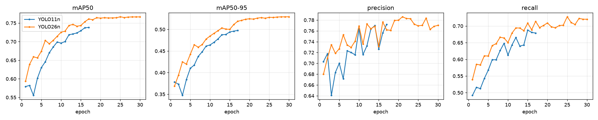
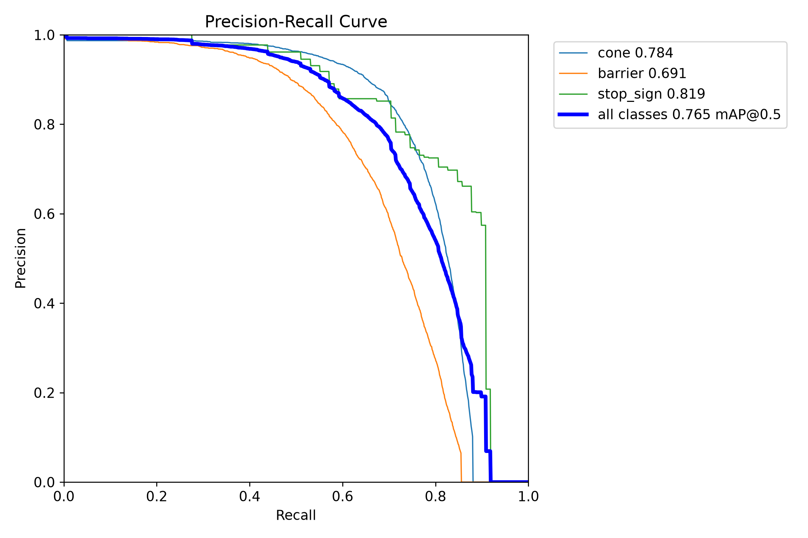
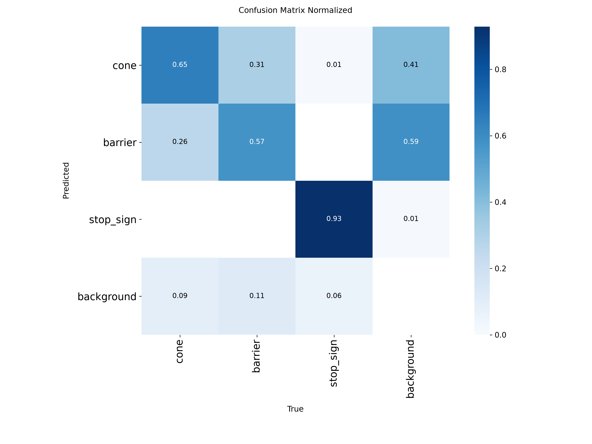
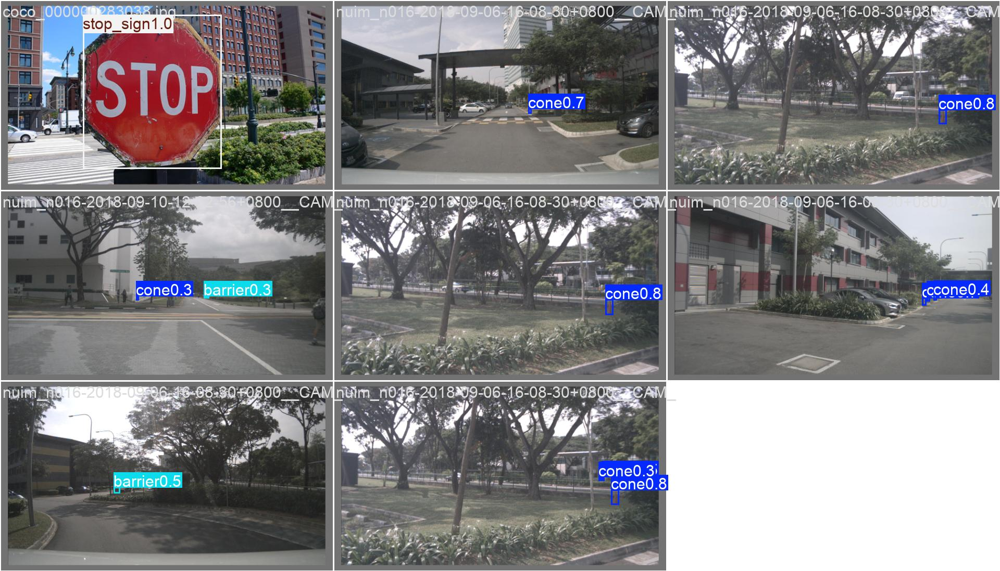
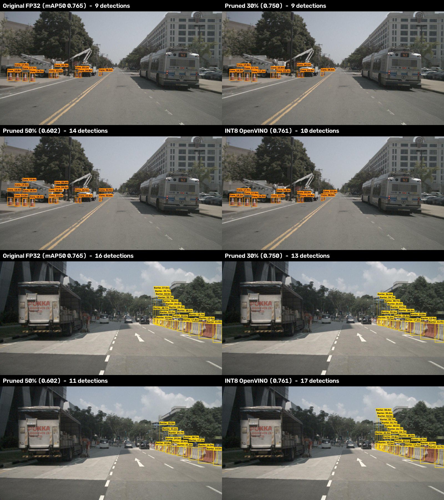

# Results

All numbers below were measured in this project; the raw files are in [`results/`](results/).
Hardware: Intel Core i5-11300H (4 cores, AVX-512 VNNI), NVIDIA GTX 1650 4 GB, Intel Iris Xe integrated GPU,
Windows 11. Validation set: 2,309 images (2,200 nuImages, 66 COCO, 43 BDD100K).

## 1. Detection accuracy

[`results/per_class_accuracy.md`](results/per_class_accuracy.md)

| Model | Epochs | mAP50 | mAP50-95 | Cone AP50 | Barrier AP50 | Stop sign AP50 | Cone recall | Barrier recall | Stop sign recall |
|---|---|---|---|---|---|---|---|---|---|
| YOLO11n | 17 | 0.738 | 0.498 | 0.758 | 0.665 | 0.792 | 0.676 | 0.558 | 0.796 |
| YOLO26n | 17 | 0.761 | 0.518 | 0.769 | 0.673 | 0.841 | 0.690 | 0.563 | 0.888 |
| **YOLO26n (final)** | **30** | **0.765** | **0.528** | **0.784** | **0.691** | **0.819** | **0.707** | **0.583** | **0.870** |

* At the **same training budget (17 epochs)** YOLO26n is ahead on every class: +2.3 mAP50, +2.0 mAP50-95.
* The extra 13 epochs mostly helped the small, hard classes (cone and barrier AP50 +1.5 and +1.8 points).
* Stop-sign AP is noisy: only 98 validation signs, mostly COCO's large, clear ones.

| Precision–recall (YOLO26n) | Confusion matrix (YOLO26n, normalised) |
|---|---|
|  |  |

Validation predictions (YOLO26n):

## 2. Distance accuracy against LiDAR

nuScenes v1.0-mini, CAM_FRONT key frames, cones and barriers at least 60 % visible (384 objects). Ground truth
is the Euclidean distance from the camera to the centre of the LiDAR-annotated 3D box. Detections are matched
to ground truth at IoU ≥ 0.3. Files: [`results/distance_*.md`](results/).

| Boxes | Matched | Cone AbsRel | Cone median error | Barrier AbsRel | Barrier median error |
|---|---|---|---|---|---|
| Oracle (projected 3D boxes) | 384 / 384 | 8.7 % | 1.28 m | 10.1 % | 2.22 m |
| YOLO11n | 362 / 384 | 5.3 % | 0.60 m | 5.3 % | 0.78 m |
| **YOLO26n** | **366 / 384** | **4.7 %** | **0.55 m** | **5.7 %** | **0.93 m** |

By true distance (YOLO26n detector):

| True distance | n | Size method | Ground-plane | Fused |
|---|---|---|---|---|
| 0–10 m | 31 | 6.8 % | **3.7 %** | 5.8 % |
| 10–20 m | 117 | **3.9 %** | 12.0 % | 5.8 % |
| 20–30 m | 133 | **4.4 %** | 31.5 % | 5.7 % |
| 30–50 m | 70 | **7.0 %** | 57.5 % | 9.7 % |
| > 50 m | 15 | **8.2 %** | 30.5 % | 11.7 % |

* The size method ($Z = fH/h$) is the most accurate beyond 10 m and is the default.
* The ground-plane method is best close up but degrades quickly: near the horizon a single pixel covers metres.
* Detector boxes beat the oracle because a projected 3D cuboid is taller on screen than the real object.

## 3. Optimisation for edge devices

### 3.1 Before vs. after — YOLO26n at 640 px

Speed is the median over 5 interleaved rounds of 20 validation images, batch 1, image already in memory
([`results/latency_*_interleaved.csv`](results/)). *Inference* is the network alone; *end-to-end* adds
letterboxing and post-processing. Accuracy is Ultralytics validation of the exported model on the full
validation set.

| Variant | Device | Size | mAP50 | mAP50-95 | Inference | End-to-end FPS |
|---|---|---|---|---|---|---|
| PyTorch FP32 (baseline) | GPU · GTX 1650 | 5.5 MB | 0.765 | 0.528 | 11.6 ms | 67.7 |
| PyTorch FP32 (baseline) | CPU | 5.5 MB | 0.765 | 0.528 | 42.4 ms | 22.3 |
| ONNX Runtime FP32 | CPU | 9.9 MB | 0.763 | 0.527 | 48.3 ms | 18.5 |
| OpenVINO FP32 | CPU | 10.0 MB | 0.763 | 0.525 | 66.0 ms | 14.2 |
| **OpenVINO INT8** (post-training quantisation) | **CPU** | **3.3 MB** | **0.761** | **0.521** | **30.9 ms** | **28.7** |
| OpenVINO FP32 | iGPU · Iris Xe | 10.0 MB | 0.763 | 0.525 | 11.8 ms | 56.8 |
| OpenVINO INT8 | iGPU · Iris Xe | 3.3 MB | 0.761 | 0.521 | 9.7 ms | 63.2 |

* **INT8 is the clear win on CPU:** 1.37× faster than PyTorch FP32 and 2.1× faster than OpenVINO FP32, and
  3× smaller than the FP32 export (10.0 → 3.3 MB), for 0.4 mAP50 points.
* iGPU rows use the same exported files; their accuracy was measured on the CPU.
* An **integrated Intel GPU running INT8 (9.7 ms) matches the discrete GTX 1650 in FP32 (11.6 ms)**.
* **GPU FP16 could not be tested:** on the GTX 1650 FP16 inference returns no detections at all, and
  Ultralytics' AMP check disables mixed precision on this card.

### 3.2 Lightweight architecture — YOLO11n vs. YOLO26n

| | YOLO11n | YOLO26n |
|---|---|---|
| mAP50 / mAP50-95 at 17 epochs | 0.738 / 0.498 | **0.761 / 0.518** |
| PyTorch FP32, GPU inference | **10.3 ms** | 11.6 ms |
| PyTorch FP32, CPU inference | 42.3 ms | 42.4 ms |
| OpenVINO INT8, CPU inference | 32.8 ms | **30.9 ms** |
| OpenVINO INT8, iGPU inference | **9.1 ms** | 9.7 ms |
| Post-processing (NMS for YOLO11n, none for YOLO26n) | 0.9 ms | 1.0 ms |

Backbone size, speed only (COCO-pretrained YOLO26s / m were not fine-tuned for lack of compute time;
[`results/latency_backbones_*.csv`](results/)):

| Backbone | Parameters | CPU inference | GPU inference |
|---|---|---|---|
| **YOLO26n** | 2.5 M | **43 ms** | **12.1 ms** |
| YOLO26s | 10.0 M | 95 ms | 13.3 ms |
| YOLO26m | 21.9 M | 251 ms | 32.8 ms |

YOLO26n's gain on this data is **accuracy**, not speed. Ultralytics advertises up to 43 % faster CPU inference;
that **did not reproduce here**: the two run at the same speed in PyTorch on this CPU and YOLO26n is only 6 %
faster in INT8. With a handful of objects per image, NMS costs under a millisecond, so removing it saves little.

### 3.3 Input resolution

OpenVINO INT8 on CPU ([`results/benchmark_openvino_pinned.csv`](results/benchmark_openvino_pinned.csv)):

| Input | mAP50 | mAP50-95 | Inference | End-to-end FPS |
|---|---|---|---|---|
| 640 px | 0.761 | 0.521 | 27.1 ms | 27.0 |
| 480 px | 0.702 | 0.472 | 15.9 ms | 40.7 |
| 320 px | 0.552 | 0.365 | 8.5 ms | 61.8 |

Small distant cones disappear at low resolution, so accuracy drops quickly below 640 px. 480 px is a reasonable
middle ground when ~40 FPS on a CPU matters more than the farthest detections.

### 3.4 Pruning

Global L1 unstructured pruning of all convolution weights (`optimization/prune.py`), no fine-tuning afterwards.
Size is the gzip-compressed FP32 weights (sparse zeros compress well).

| Model | Weights pruned | mAP50 | mAP50-95 | Compressed size | GPU FPS | CPU FPS |
|---|---|---|---|---|---|---|
| YOLO26n | 0 % | 0.765 | 0.528 | 6.13 MB | 61.2 | 22.9 |
| YOLO26n | 30 % | 0.750 | 0.487 | 4.89 MB | 59.3 | 22.2 |
| YOLO26n | 50 % | 0.602 | 0.342 | 3.92 MB | 59.2 | 22.8 |
| YOLO11n | 0 % | 0.738 | 0.496 | 6.27 MB | 65.4 | 22.7 |
| YOLO11n | 30 % | 0.737 | 0.496 | 4.97 MB | 64.3 | 22.9 |
| YOLO11n | 50 % | 0.725 | 0.486 | 3.99 MB | 65.3 | 22.4 |

* **No speed-up**, as expected: the zeros still sit inside dense tensors, and neither PyTorch nor OpenVINO
  skips them without structured pruning or sparse kernels. The gain is compressed size only.
* YOLO11n tolerates pruning far better than YOLO26n (50 % costs it 1.3 mAP50 points vs. 16 points).
  YOLO26n's weights appear to be used more evenly, which leaves fewer near-zero weights to remove.
* For this project INT8 quantisation is the better tool: smaller *and* faster for a 0.4-point cost.

**Before vs. after on the same frames** (YOLO26n, nuScenes, real calibration): the original model, 30 % and
50 % pruning, and INT8 quantisation. 30 % pruning and INT8 look like the original; at 50 % the model produces
duplicate boxes on the Boston cones (14 detections instead of 9) and loses the far barriers in Singapore
(11 instead of 16).

### 3.5 Measurement notes

* The first benchmark runs ([`results/benchmark_yolo11n.csv`](results/benchmark_yolo11n.csv),
  [`results/benchmark_yolo26n.csv`](results/benchmark_yolo26n.csv)) passed `device=cpu` to OpenVINO models.
  On a machine with several OpenVINO devices Ultralytics then compiles for `AUTO`, which can run on the
  integrated GPU, so their OpenVINO speeds are **not** CPU numbers. They are kept for transparency and are
  superseded by [`results/benchmark_openvino_pinned.csv`](results/benchmark_openvino_pinned.csv) and the
  interleaved latency files, which pin `intel:cpu` / `intel:gpu`.
* End-to-end FPS in the benchmark CSVs includes reading and decoding a 1600×900 JPEG from disk; the
  interleaved latency files do not.

## 4. Dataset

[`results/dataset_stats.txt`](results/dataset_stats.txt)

| Split | Images | Cone | Barrier | Stop sign |
|---|---|---|---|---|
| train | 15,145 | 36,907 | 37,712 | 2,067 |
| val | 2,309 | 6,535 | 6,570 | 98 |
